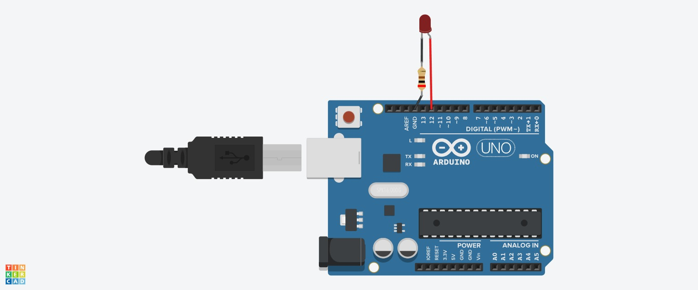

# ⚡ Arduino 10x LED Blink Project

Arduino Uno circuit and C++ code created in Tinkercad that blinks a Red LED exactly 10 times using a `for` loop.

## 📐 Circuit Diagram

## 🔗 Live Interactive Simulation
[Click here to simulate on Tinkercad](https://www.tinkercad.com/things/0byveuED3n8-snehaarduino10xblink)

